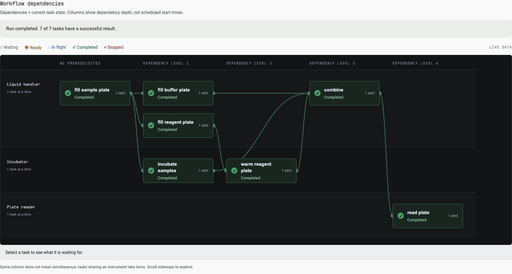
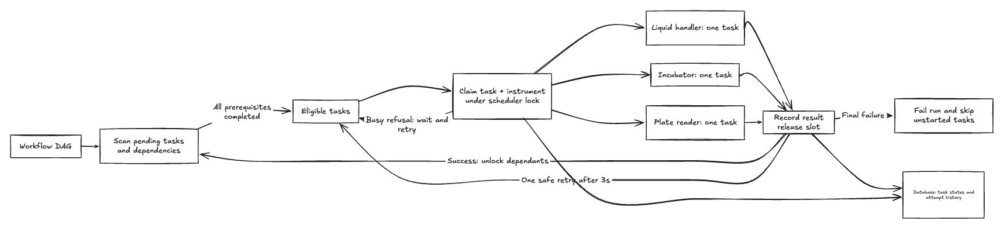

# Implementation notes

## Summary

Built a scheduler that shares instruments safely, runs independent tasks
concurrently, and handles failures with bounded retries and durable attempt history.

**Time:** A little under two hours, plus approximately 30 minutes for the visualiser.
AI assisted study, design, implementation and verification.

## Mental model

Each experiment is a dependency graph; all experiments share three instruments,
each with one execution slot. A command being accepted is not completion. Only a
successful result unlocks dependent tasks.

I traced the existing code first. The baseline sent no commands: one task was
ready and six were waiting.

Baseline observation

Columns represent dependency depth, not scheduled time.

Final workflow observation — clean live run

Same workflow after implementation: seven tasks completed once each in 12 seconds,
with dependencies respected and independent work overlapping. All five acceptance
checks passed; errors and dropped results were disabled.

Incubation can overlap liquid handling; fill tasks take turns. Combining waits
for all three prerequisite branches.

## Components, decisions and tradeoffs

| Component | Choice over alternative | Tradeoff |
| --- | --- | --- |
| Dependencies | Scan pending tasks rather than maintain Kahn’s dependency counters: fewer consistency rules. | O(V + E) per active run per scan; ordering is simple, not fair or optimal. |
| Coordination | Hold one scheduler lock through claims and acknowledgements rather than release it before sending: simpler state transitions. | Simultaneous results cannot double-dispatch; slow I/O delays scheduling, not physical execution. |
| Busy handling | Rescan after 250 ms rather than wait only for another result: refused work cannot be stranded. | Repeated polling while busy; refusals do not consume retries. |
| Retries | Retry explicitly retryable failures once after three seconds rather than fail immediately. | Handles transient errors while bounding repeated work; equipment is released during backoff. |
| Final failure | Stop new work across the run rather than continue unaffected branches. | Independent work is skipped; already-dispatched outcomes remain recorded and other runs continue. |
| History | Preserve attempt events rather than overwrite each outcome with the latest state. | Extra records retain errors and the causal failure; attempt IDs reject stale results. |

## Operational boundaries

An acknowledgement timeout fails the run but retains the instrument reservation
until a result arrives: acceptance is unknown. A missing completion result leaves
the task in flight indefinitely with its reservation. Neither case triggers blind
replay; an unknown physical outcome needs confirmation before recovery.

The main weakness is a process crash between database claim and command delivery.
The scheduler operates in one process and does not resume stored runs on restart;
those cases need reconciliation. Attempt IDs correlate results, not deduplicate
commands at the driver.

## Verification

- Both workflows: **5/5 acceptance checks**; **12 pytest tests**, persistent-failure
  check and lint passed. Pytest uses a separate database.
- Four concurrent runs: **26 tasks completed**, with four injected transient
  failures and four successful retries.

## Exercise feedback

- I really enjoyed the realistic lab workflow; the problem statement was clear.
- As a visual thinker, the GitHub Actions-inspired visualiser made the flow click
  and was worth the time.
- Docker and real PostgreSQL removed uncertainty about infrastructure scope.
- My only suggested change: include a basic visualisation in the starter pack.
