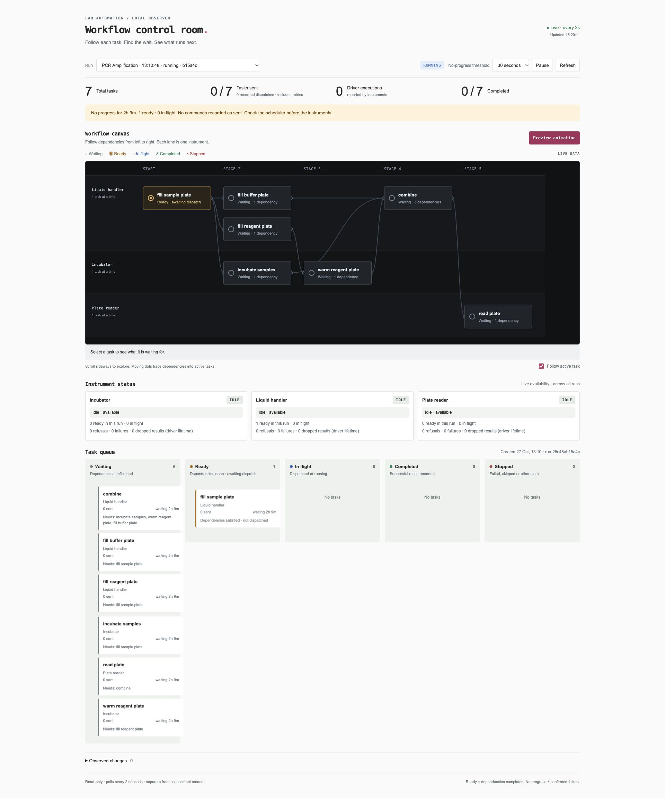
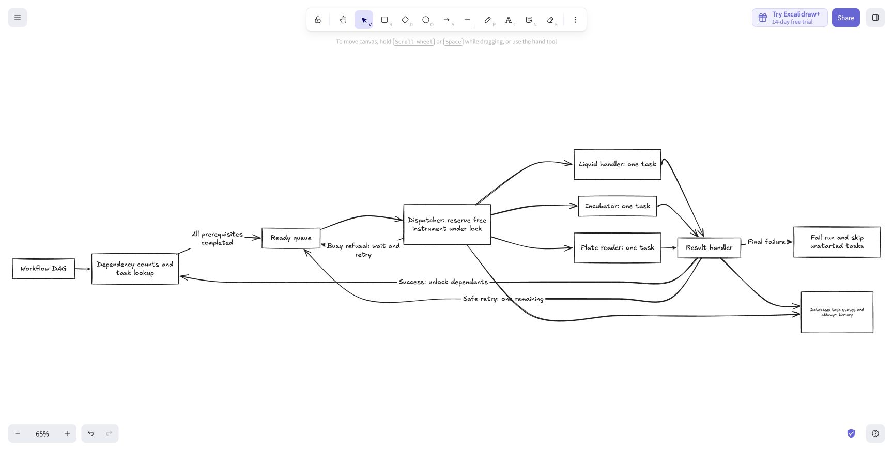

# Study and implementation notes

Draft checkpoint. Total time still needs reconciling across setup, study,
implementation, testing and the optional visualisation. AI assisted the study,
design, implementation and verification. The extension and final reflection are
unfinished.

## Study first

We read the starter code, traced a run from API to driver and ran the baseline
checks before implementing the scheduler. The stub changed run status but sent no
commands: the default workflow stayed at one ready task and six waiting tasks.

| Read | Finding |
| --- | --- |
| [Workflow and loader](config/workflows.yaml), [validation](services/executor/workflows.py) | A DAG with run-local dependencies and fixed device assignments. |
| [API](services/executor/api.py), [original scheduler](https://github.com/dance-cmdr/lab-workflow/blob/3e19f22/services/executor/scheduler.py) | Two scheduling triggers: start and result. Dispatch was missing. |
| [Store](services/executor/store.py), [schema](db/init.sql) | Postgres owns task/run states, counts and timestamps. |
| [Bus](services/executor/bus.py), [driver](services/worker/main.py) | Acceptance is separate from completion. Results arrive concurrently; busy devices refuse. |
| [Acceptance checks](scripts/acceptance.sh), [concurrency test](tests/test_scheduler_concurrency.py) | Check completion, dependencies, overlap, duplicates and simultaneous results. |

*Historical read-only observer, kept outside the submission. “Stage” means
dependency depth, not scheduled time.*

## Decomposition and decisions

**Start → scan dependencies → claim task and instrument → dispatch → record
result → release instrument → rescan or finish.**

After `fill_sample_plate`, incubation and both fill tasks become eligible.
Incubation can overlap filling; the fills share one liquid handler. `combine`
waits for incubation, buffer filling and reagent warming.

*Proposal, not as-built architecture: counters, safe retries, skipped states and
attempt history were discussed; they are not all implemented.*

- **Scan rather than maintain counters:** fewer consistency rules; O(V + E) per
  run scanned. Each event scans all tracked active runs.
- **One lock across runs:** prevents simultaneous results claiming the same task
  or instrument. It covers database changes and acknowledgements, not physical
  execution. Slow acknowledgements delay scheduling decisions.
- **Claim before sending:** reserve the task and instrument. Only completion
  unlocks dependants. Duplicate or mismatched results are ignored.
- **Refusal is not failure:** undo the claim and rescan after 250 ms, even if no
  other result arrives. This resends declined work, not failed physical work.
- **Reported failure ends its run:** stop new dispatches, record late results and
  keep other runs moving. Late success cannot revive a failed run. Unstarted
  tasks currently remain pending.
- **Unknown acknowledgement is not refusal:** fail the run, retain the diagnostic
  and instrument reservation, and never blindly resend. Release on an actual
  result. Driver-side deduplication would be needed for safe command replay.

## Evidence

- Both supplied workflows: **5/5 acceptance checks passed**.
- Pytest: **5 passed**, including simultaneous results, refusals, shared equipment,
  duplicate results, late completion after failure and uncertain acknowledgements.
- Live failure check and lint passed; drivers restored to normal.
- Pytest now uses separate PostgreSQL storage. Live acceptance runs use the real
  executor and drivers. Driver acceptance history resets on restart.

## Limits and next step

One executor process; no automatic restart recovery, distributed coordination or
atomic database/message delivery. Crashes between claim and send, or between
step failure and run failure, need reconciliation. A dropped result leaves the
run waiting and the instrument reserved indefinitely. Recovery must establish
what physically happened; a timeout alone cannot justify repeating work.

**Production recovery proposal — not implemented:** for an overdue result, check
instrument heartbeat, current operation and command identity, then reconcile
execution history with the last confirmed experiment/labware state. Use evidence
from neighbouring tasks only when traceably linked to the same experiment;
liveness or an idle instrument alone does not prove success. If the outcome
remains unknown, abandon the run and start fresh only after confirming the old
operation has stopped, equipment is safe, and fresh materials or a validated
reset are available. Automatic restart assumes no outstanding cleaning or
decontamination requirements. The supplied interfaces do not establish all of
these conditions.

Start order and alphabetical task order are deterministic, not fair or optimal.
The seven-step workflow completed in approximately 12 seconds.

Next: bounded safe retries, explicit skipped states and append-only attempt
history. Write state/history together transactionally where possible. Finalise
actual time spent and exercise feedback before submission.
